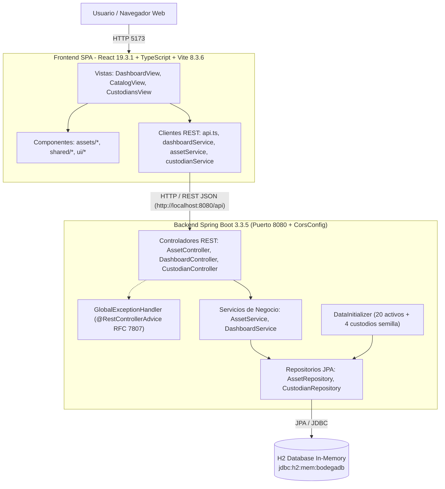
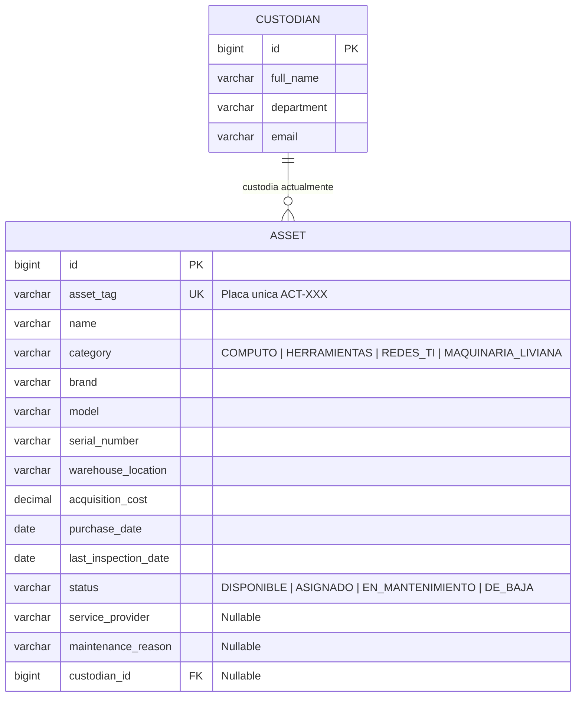
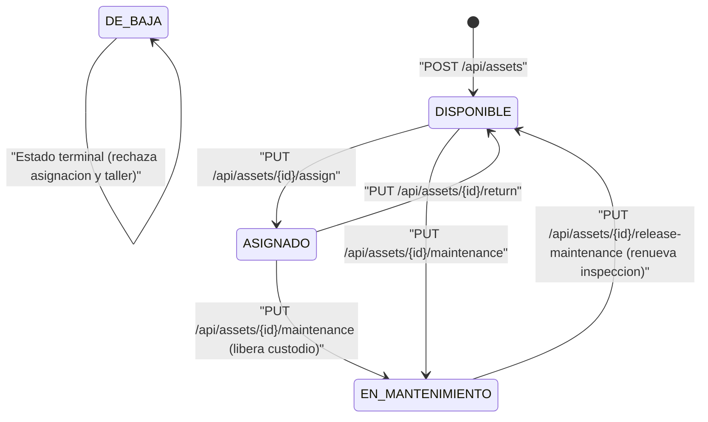
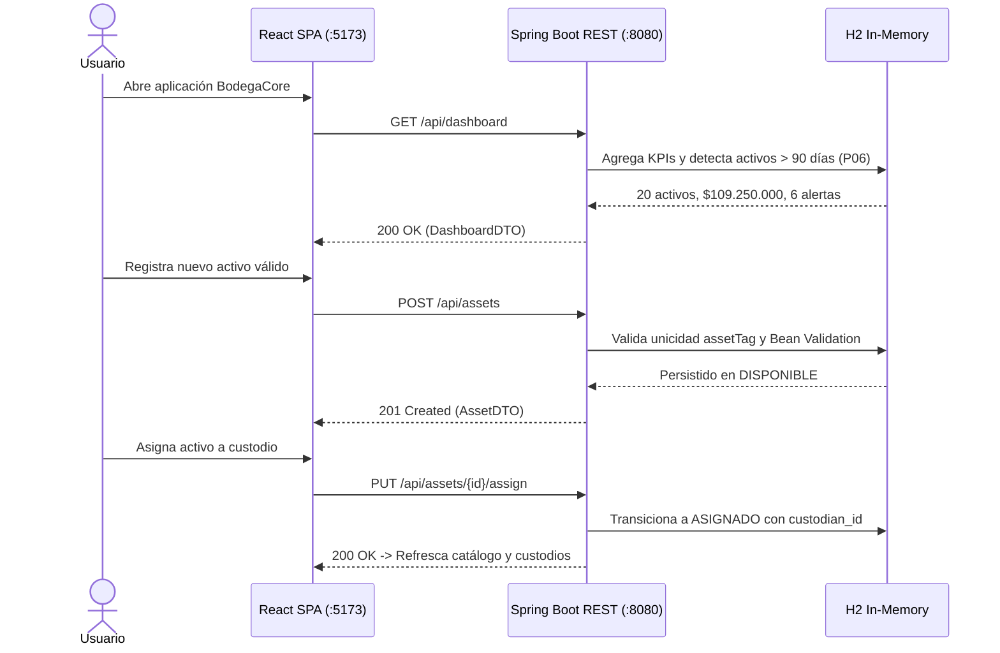

# BodegaCore — Sistema de Administración de Activos de Bodega
## Laboratorio de Construcción Asistida por IA (Diseño del Sistema)

- **Autor / Estudiante**: **Brahian Ospina**
- **Metodología**: Desarrollo asistido por IA guiado por especificaciones con **OmniSpec (`v0.9.0`)**, Google Antigravity IDE y Google Stitch, siguiendo [Guia_Laboratorio_IA.pdf](Guia_Laboratorio_IA.pdf)
- **Informe Académico Completo (PDF)**: [INFORME-LABORATORIO.pdf](INFORME-LABORATORIO.pdf)
- **Especificación Técnica y PRD**: [PRD.md](PRD.md) | [SPEC-TECNICA.md](SPEC-TECNICA.md) | [design.md](design.md)

Prototipo empresarial para el control de inventario físico, trazabilidad de custodia, valorización patrimonial y seguimiento de ciclos de mantenimiento preventivo para activos de bodega (equipos de cómputo, herramientas especializadas, infraestructura TI y maquinaria liviana).

---

## 1. Stack Tecnológico Verificado

Las siguientes versiones coinciden exactamente con los manifiestos del repositorio ([backend/pom.xml](backend/pom.xml) y [frontend/package.json](frontend/package.json)):

- **Backend**:
  - Lenguaje: Java con bytecode configurado en `<java.version>17</java.version>`, compilado y verificado en el host con OpenJDK `25.0.4.1` Temurin LTS.
  - Framework: Spring Boot `3.3.5` (`spring-boot-starter-web`, `spring-boot-starter-data-jpa`, `spring-boot-starter-validation`, `spring-boot-starter-test`).
  - ORM / Base de Datos: Hibernate `6.5.3` + H2 In-Memory Database (`jdbc:h2:mem:bodegadb;DB_CLOSE_DELAY=-1`).
  - Motor de Construcción: Maven Wrapper (`mvnw.cmd` / `mvnw`).
  - Manejo de Errores y Documentación: RFC 7807 `ProblemDetail` (`GlobalExceptionHandler`) y Javadoc en controladores, servicios y repositorios.
- **Frontend**:
  - Runtime: Node.js `v24.22.1` / npm `11.19.1`.
  - Librería y Lenguaje: React `^19.3.1` con TypeScript `~7.0.2` (`.tsx`) sobre Vite `^8.3.6`.
  - Estilos e Iconografía: Tailwind CSS `^3.4.19`, `lucide-react` `^1.71.0`, `class-variance-authority` `^0.7.1`, tokens industriales sobrios ([design.md](design.md), sin clichés visuales de IA).
  - Arquitectura de Componentes: Primitivas atómicas propias estilo *shadcn/ui* en `src/components/ui/` (`button`, `card`, `badge`, `input`, `select`, `textarea`, `table`, `dialog`, `sheet`, `skeleton`, `tabs`).
  - Calidad y Linter: Estándar *Better UI* (`active:scale-[0.96]`, scroll containment, 4 estados obligatorios) y linter `oxlint` `^1.90.0` (`0` warnings / `0` errors).
  - Vistas Integradas: `DashboardView`, `CatalogView` y `CustodiansView`, consumiendo al 100 % la API REST de Spring Boot.

---

## 2. Arquitectura del Sistema y Diagramas

### 2.1 Arquitectura General en Capas



### 2.2 Modelo Entidad-Relación (`H2` / `JPA`)



### 2.3 Ciclo de Vida de Estados del Activo (`AssetService.java`)



### 2.4 Flujo de Secuencia Principal (Tablero, Validación y Asignación)



### 2.5 Resumen de Endpoints REST (`http://localhost:8080/api`)

| Método | Ruta | Descripción |
| :--- | :--- | :--- |
| `GET` | `/api/dashboard` | KPIs ejecutivos, valorización COP, tasas, distribución y sugerencias `P06` |
| `GET` | `/api/assets` | Catálogo filtrable (`category`, `status`, `critical`, `olderThan90Days`, `search`) |
| `GET` | `/api/assets/{id}` | Detalle técnico de un activo |
| `POST` | `/api/assets` | Registro de nuevo activo (`201 Created` o `400 ProblemDetail`) |
| `PUT` | `/api/assets/{id}/assign` | Asigna activo `DISPONIBLE` a un custodio (`ASIGNADO`) |
| `PUT` | `/api/assets/{id}/return` | Registra devolución a bodega (`DISPONIBLE`) |
| `PUT` | `/api/assets/{id}/maintenance` | Envía activo a taller técnico (`EN_MANTENIMIENTO`) |
| `PUT` | `/api/assets/{id}/release-maintenance` | Libera activo de taller a `DISPONIBLE` y actualiza `lastInspectionDate` |
| `GET` | `/api/assets/recommendations` | Lista activos `> 90` días sin inspección (excluyendo `DE_BAJA`) |
| `GET` | `/api/custodians` | Listado de custodios con total de activos asignados (`P05`) |
| `GET` | `/api/custodians/{id}/assets` | Listado de activos asignados a un custodio específico |

---

## 3. Requisitos Previos e Instrucciones de Ejecución

### 3.1 Requisitos Previos
1. **Java**: JDK `17` o superior instalado (`java -version`). *(Probado en OpenJDK `25.0.4.1`)*.
2. **Node.js y npm**: Node.js `v18.0` o superior (`node -v`) y `npm` (`npm -v`). *(Probado en `v24.22.1` / `11.19.1`)*.
3. **Navegador Web**: Chrome, Edge o Firefox actualizado.
4. **Git**: Recomendado para control de versiones local (`git --version`).

### 3.2 Puesta en Marcha del Backend (Spring Boot + H2)

```powershell
cd backend
.\mvnw.cmd spring-boot:run
```
*(En Linux/macOS: `./mvnw spring-boot:run`)*

- **URL base de API**: `http://localhost:8080/api`
- **Consola H2 (solo desarrollo local)**: `http://localhost:8080/h2-console`
  - **JDBC URL**: `jdbc:h2:mem:bodegadb`
  - **Usuario**: `sa`
  - **Contraseña**: *(vacía)*
- **Datos semilla**: `DataInitializer.java` carga automáticamente **20 activos** y **4 custodios** en memoria al iniciar.

### 3.3 Puesta en Marcha del Frontend (React + Vite)

En una segunda terminal desde la raíz del proyecto:

```powershell
cd frontend
npm install
npm run dev
```

- **URL de la aplicación**: `http://localhost:5173/` (verifique el puerto exacto que informe Vite en consola).

### 3.4 Pruebas Automatizadas, Linter y Verificación REST Rápida

- **Suite de pruebas del backend (`11` pruebas JUnit 5 + MockMvc + JPA sobre H2)**:
  ```powershell
  node run-tests.mjs
  ```
  *(O directamente dentro de `backend/`: `.\mvnw.cmd test`)*

- **Compilación TypeScript + Bundle Vite y Linter `oxlint` del frontend**:
  ```powershell
  cd frontend
  npm run build
  npm run lint
  ```

- **Prueba REST directa de verificación en PowerShell** (con backend encendido):
  ```powershell
  Invoke-RestMethod -Uri "http://localhost:8080/api/dashboard" -Method Get
  Invoke-RestMethod -Uri "http://localhost:8080/api/assets?critical=true" -Method Get
  Invoke-RestMethod -Uri "http://localhost:8080/api/assets?olderThan90Days=true" -Method Get
  ```

---

## 4. Matriz de Pruebas Diligenciada y Evidencias Reales

### 4.1 Evidencia Automatizada y REST en Vivo
- **Backend (`.\mvnw.cmd test`)**: `11/11` pruebas exitosas (`BodegacoreApplicationTests`, `AssetRepositoryTest`, `AssetServiceTest`, `AssetControllerIntegrationTest`, `DashboardControllerIntegrationTest`), `0` fallos, `BUILD SUCCESS`.
- **Frontend (`npm run build` + `npm run lint`)**: compilación TypeScript/Vite limpia y `oxlint` con `Found 0 warnings and 0 errors` en `38` archivos.
- **Llamadas REST directas sobre `http://localhost:8080` con H2 recién iniciado**:
  - `GET /api/dashboard` $\to$ `HTTP 200 OK`: `totalAssets: 20`, `totalValuation: 109250000.00`, `availabilityRate: 50.0`, `DISPONIBLE: 10`, `ASIGNADO: 6`, `EN_MANTENIMIENTO: 3`, `DE_BAJA: 1`, `recommendations: 6`.
  - `GET /api/assets?critical=true` $\to$ `HTTP 200 OK` (`3` registros).
  - `GET /api/assets?olderThan90Days=true` $\to$ `HTTP 200 OK` (`7` registros).
  - `GET /api/custodians` $\to$ `HTTP 200 OK` (`4` registros).
  - `POST /api/assets` con `acquisitionCost: -100` $\to$ `HTTP 400 Bad Request` (`ProblemDetail` con `invalidFields.acquisitionCost`).

### 4.2 Casos Funcionales de la Guía (`P01` a `P10`)

| ID | Caso de Prueba (Guía / Flujo) | Resultado Esperado | Resultado Observado (Evidencia Real) | Estado |
| :---: | :--- | :--- | :--- | :---: |
| **P01** | **Abrir Dashboard y carga inicial** | Muestra al menos 20 registros y métricas coherentes con la API. | H2 inicia con 20 activos; Dashboard en vivo muestra `20` activos, `$ 109.250.000`, `50%` disponibilidad y banner de `6` alertas ([captura](specs/002-cierre-entregable-calidad/evidence/dashboard-desktop.png)). | **APROBADO** |
| **P02** | **Consultar catálogo y alta de activo** | Tabla muestra registros del backend; alta valida placa única y costo > 0. | Catálogo renderiza los 20 activos desde `/api/assets`; `POST /api/assets` valida unicidad (`201`/`400`) y modal abre con campos obligatorios ([catálogo](specs/002-cierre-entregable-calidad/evidence/catalog-desktop.png), [modal](specs/002-cierre-entregable-calidad/evidence/modal-create-desktop.png)). | **APROBADO** |
| **P03** | **Filtrar productos críticos** | Solo se muestran los activos críticos en mantenimiento. | Botón "Filtro Crítico / Taller (P03)" y `GET /api/assets?critical=true` retornan exactamente `3` activos en `EN_MANTENIMIENTO` (`ACT-017`, `ACT-018`, `ACT-019`). | **APROBADO** |
| **P04** | **Filtrar por antigüedad (>90 días)** | Solo aparecen activos con más de 90 días sin inspección. | "Antigüedad > 90 Días (P04)" y `GET /api/assets?olderThan90Days=true` retornan exactamente `7` activos con badge `> 90d`. | **APROBADO** |
| **P05** | **Consultar custodios** | Se presenta el listado de custodios y activos bajo su responsabilidad. | Pestaña "Custodios" lista 4 custodios reales desde `/api/custodians` (ej. Ing. Carlos Mendoza con `ACT-011` y `ACT-012`) ([captura](specs/002-cierre-entregable-calidad/evidence/custodians-desktop.png)). | **APROBADO** |
| **P06** | **Sugerencia preventiva de mantenimiento** | Recomendación basada en reglas definidas, no texto estático. | Backend calcula `6` recomendaciones para activos >90d excluyendo `DE_BAJA` y las expone en `RecommendationsBanner`. | **APROBADO** |
| **P07** | **Probar datos vacíos o error de API** | Interfaz presenta mensaje útil con recuperación y no se bloquea. | Búsqueda `'NOEXISTE'` en catálogo renderiza `EmptyState` con CTA "Restablecer filtros" que restaura el listado ([captura](specs/002-cierre-entregable-calidad/evidence/catalog-empty-desktop.png)); `ErrorAlert` ofrece botón de reintento. | **APROBADO** |
| **P08** | **Validar formularios** | Campos obligatorios y valores inválidos se gestionan correctamente. | Inputs obligatorios HTML5 + validación cliente/servidor (`POST /api/assets` con costo `-100` retorna `HTTP 400` con `invalidFields`). | **APROBADO** |
| **P09** | **Recargar y reiniciar (H2 en memoria)** | Se documenta el reinicio de datos en RAM al reiniciar backend. | Antes del reinicio la instancia previa tenía `12 DISPONIBLE / 1 EN_MANTENIMIENTO`; al reiniciar `mvnw.cmd spring-boot:run`, H2 volvió a `10 DISPONIBLE / 6 ASIGNADO / 3 EN_MANTENIMIENTO / 1 DE_BAJA`. | **APROBADO** |
| **P10** | **Revisar diseño adaptable (Responsive)** | Interfaz conserva legibilidad en distintos tamaños de ventana. | En `1280x800` no hay desbordamiento (`scrollWidth: 1265`); en móvil (`500x812`) las tarjetas KPI apilan en 1 columna con texto legible ([captura móvil](specs/002-cierre-entregable-calidad/evidence/dashboard-mobile.png)), detectándose desbordamiento horizontal menor en `TopNavbar` (`571px` vs `500px`, registrado en §5). | **APROBADO (con hallazgo menor)** |

---

## 5. Hallazgos de Calidad, Deuda Técnica y Limitaciones

Conforme a la Fase 8 y Anexo A de [Guia_Laboratorio_IA.pdf](Guia_Laboratorio_IA.pdf):

1. **Seguridad y Exposición (No apto para producción)**:
   - El prototipo v1.0 no incluye autenticación ni control de roles (RBAC), según lo delimitado en [PRD.md](PRD.md).
   - La consola H2 está habilitada en `/h2-console` con `spring.h2.console.settings.web-allow-others=true` en [application.properties](backend/src/main/resources/application.properties); debe deshabilitarse fuera de desarrollo local.
2. **Persistencia Volátil en Memoria**:
   - H2 opera con `jdbc:h2:mem:bodegadb` y `ddl-auto=create-drop`: cualquier cambio ejecutado durante la sesión se pierde al detener o reiniciar el servidor backend.
3. **Alcance Diferido respecto a CRUD Completo**:
   - La edición de activos existentes (`PUT /api/assets/{id}`) y la transición manual desde UI hacia `DE_BAJA` quedan documentadas como mejoras futuras en [PRD.md](PRD.md).
4. **Deuda Técnica Menor en Interfaz y Accesibilidad**:
   - **Responsive en barra superior**: A `500px` de ancho, [TopNavbar.tsx](frontend/src/components/shared/TopNavbar.tsx) presenta `scrollWidth = 571px` sobre `innerWidth = 500px` por mantener los botones de navegación en línea sin `flex-wrap`.
   - **Asociación `label`/`for` en formularios**: Chrome DevTools reportó `9` campos sin `<label for=...>` asociado y `12` campos sin `id`/`name`.
5. **Deuda Menor en Backend y Cobertura de Tests UI**:
   - Hibernate `6.5.3` emite el warning `HHH90000025` porque `spring.jpa.database-platform=org.hibernate.dialect.H2Dialect` en [application.properties](backend/src/main/resources/application.properties) puede omitirse para autodetección.
   - El backend posee `11` pruebas automatizadas (`JUnit 5`); el frontend se valida mediante `tsc -b`, `vite build`, `oxlint` (`0` errores/`0` warnings) e inspección en Chrome DevTools (sin suite Vitest/Playwright configurada).

---

## 6. Checklist de Entrega (Anexo A de la Guía)

- [x] `PRD.md` revisado y consistente con el problema del negocio ([PRD.md](PRD.md)).
- [x] Mockups exportados y guardados en la carpeta del proyecto ([mockups/stitch/](mockups/stitch/)).
- [x] `SPEC-TECNICA.md` actualizado con decisiones aprobadas ([SPEC-TECNICA.md](SPEC-TECNICA.md)).
- [x] Backend compila, pasa sus pruebas (`11/11`) y arranca sin errores bloqueantes.
- [x] Frontend instala dependencias, pasa compilación/linter (`0` errores) y arranca correctamente.
- [x] Al menos una ruta REST probada directamente (probados 5 escenarios REST en vivo).
- [x] Los datos mostrados en la interfaz proceden al 100 % del backend.
- [x] Matriz de pruebas (`P01`–`P10`) completada con evidencias reales.
- [x] Hallazgos de calidad y limitaciones documentados con transparencia.
- [x] `README.md` y [INFORME-LABORATORIO.pdf](INFORME-LABORATORIO.pdf) con diagramas e instrucciones reproducibles.

### 6.1 Contraste Directo con los Requerimientos del Docente (`Guia_Laboratorio_IA.pdf`)

| Requerimiento de la Guía Docente | Cumplimiento Verificado en BodegaCore |
| :--- | :--- |
| **Caso de estudio propio (Sección 7)** | *Administración de Activos de una Bodega* (Cómputo, Herramientas, Redes TI, Maquinaria Liviana). |
| **Fase 1 — Entorno y versiones reales** | OpenJDK `25.0.4.1` (bytecode `17`), Spring Boot `3.3.5`, React `19.3.1`, Vite `8.3.6`, Node `v24.22.1`, `mvnw.cmd`. |
| **Fase 2 — PRD antes de código** | [PRD.md](PRD.md) aprobado vía `/omni-discuss` con alcance MVP y exclusiones explícitas (Fase Futura). |
| **Fase 3 — Mockups en Google Stitch** | [design.md](design.md) + exportaciones HTML/PNG en [mockups/stitch/](mockups/stitch/). |
| **Fase 4 — Especificación técnica (`§6.4.1`)** | [SPEC-TECNICA.md](SPEC-TECNICA.md) v1.2 con capas, ER, API REST (`11` rutas), árbol frontend, H2 y Plan de Pruebas. |
| **Fase 5 — Backend Spring Boot + Frontend React** | Controladores/Servicios/Repos JPA + RFC 7807 `ProblemDetail` + `20` activos semilla; SPA sin `ComponentShowcase.tsx` y `oxlint` `0` warnings. |
| **Fase 6 — Ejecución local y prueba REST** | Backend (`8080`), Frontend (`5173`), consola `/h2-console` solo dev y 5 pruebas REST ejecutadas en vivo. |
| **Fase 7–8 — Pruebas `P01`–`P10` y Auditoría** | `11/11` tests JUnit, matriz `P01`–`P10` con `7` capturas reales y §5 transparente de hallazgos/deuda técnica. |
| **Anexo A e Informe PDF** | Todos los entregables exigidos consolidados en repositorio GitHub e [INFORME-LABORATORIO.pdf](INFORME-LABORATORIO.pdf). |

---

## 7. Estructura de Entregables del Repositorio

```
c:\dev\Laboratorio_IA\
├── .gitignore                     # Exclusiones globales (target, node_modules, dist, logs)
├── INFORME-LABORATORIO.pdf        # Informe académico completo en PDF (Brahian Ospina, OmniSpec + diagramas)
├── PRD.md                         # Documento de Requerimientos de Producto (Aprobado)
├── SPEC-TECNICA.md                # Especificación técnica, API, modelo y Plan de Pruebas
├── README.md                      # Manual reproducible, arquitectura, matriz P01-P10 y hallazgos
├── design.md                      # Sistema de diseño BodegaCore Industrial Asset
├── run-tests.mjs                  # Script raíz para ejecutar suite de pruebas backend
├── Guia_Laboratorio_IA.pdf        # Guía oficial de referencia de la práctica
├── mockups/
│   └── stitch/                    # Mockups exportados desde Stitch (PNG y HTML)
│       ├── dashboard.html / .png
│       ├── catalogo.html / .png
│       └── modal_asignacion.html / .png
├── specs/                         # Trazabilidad OmniSpec (001, 002, project-context y evidence/)
├── backend/                       # Módulo Backend Spring Boot 3.3.5 + H2
│   ├── mvnw.cmd / mvnw            # Maven Wrapper
│   ├── pom.xml                    # Dependencias Web, JPA, H2, Validation, Test
│   └── src/
│       ├── main/java/com/bodegacore/
│       │   ├── model/             # Asset, Custodian, AssetCategory, AssetStatus
│       │   ├── repository/        # AssetRepository, CustodianRepository
│       │   ├── service/           # AssetService, DashboardService
│       │   ├── controller/        # AssetController, DashboardController, CustodianController
│       │   ├── dto/               # DTOs y Request Payloads
│       │   ├── exception/         # GlobalExceptionHandler (RFC 7807 ProblemDetail)
│       │   └── config/            # DataInitializer (20 activos / 4 custodios) y CorsConfig
│       └── test/java/com/bodegacore/ # Suite de 11 pruebas unitarias e integración
└── frontend/                      # Módulo Frontend React 19.3.1 (TypeScript + Tailwind)
    ├── package.json
    ├── tailwind.config.js         # Tokens de color y bordes industriales
    └── src/
        ├── types/                 # Interfaces y contratos estrictos (asset.ts)
        ├── lib/                   # Utilidades cn(), formatCOP() y formatDate()
        ├── services/              # api.ts, assetService, custodianService, dashboardService
        ├── components/
        │   ├── ui/                # Primitivas estilo shadcn/ui con Better UI
        │   ├── shared/            # TopNavbar, Skeletons (CLS=0), EmptyState, ErrorAlert
        │   └── assets/            # KPISection, DistributionBar, Recommendations, Filters, Table, Modals
        └── views/
            ├── DashboardView.tsx  # Tablero Ejecutivo con métricas en vivo
            ├── CatalogView.tsx    # Catálogo con filtros desacoplados P03 y P04
            └── CustodiansView.tsx # Directorio de custodios (P05)
```
