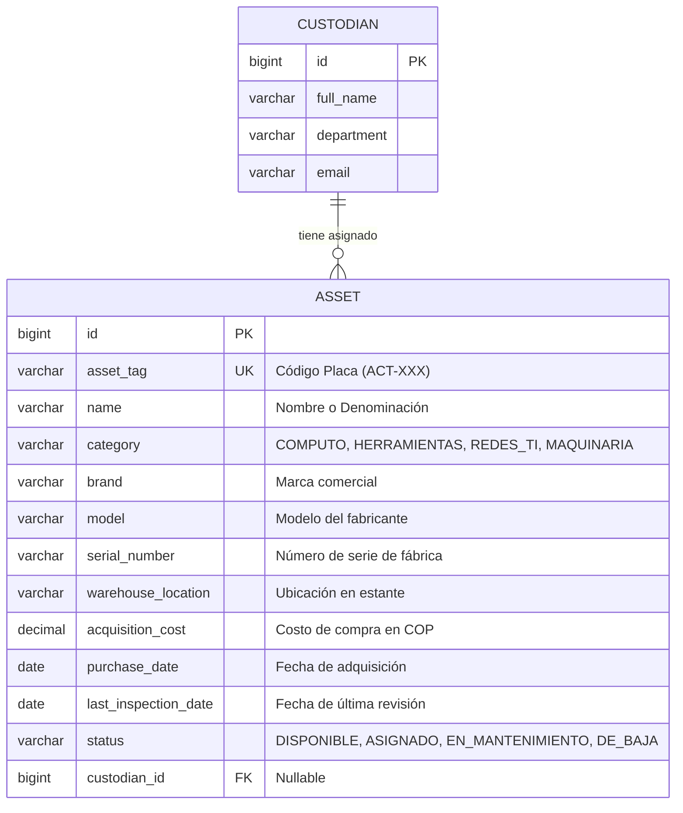

# Especificación Técnica de Implementación (SPEC-TECNICA)
## Sistema de Administración de Activos de Bodega (Equipos / Herramientas / TI)

- **Asignatura**: Diseño del Sistema
- **Proyecto**: Laboratorio de Construcción Asistida por IA
- **Versión**: 1.2 (Cierre MVP — Alineado con código real y Plan de Pruebas)
- **Fecha**: 15 de noviembre de 2026
- **Estado**: Aprobado e Implementado

---

## 1. Arquitectura General del Sistema

La solución adopta una arquitectura en capas desacoplada con versiones verificadas en manifiestos ([backend/pom.xml](backend/pom.xml) y [frontend/package.json](frontend/package.json)):

- **Backend**: Java `17` (bytecode configurado en `pom.xml`, ejecutado en OpenJDK `25.0.4.1`), Spring Boot `3.3.5`, Spring Data JPA + Hibernate `6.5.3`, Bean Validation, H2 In-Memory.
- **Frontend**: React `19.3.1`, TypeScript `~7.0.2`, Vite `8.3.6`, Tailwind CSS `3.4.19`, `lucide-react` `1.71.0`, `class-variance-authority` `0.7.1`, `oxlint` `1.90.0`.

```
[ Cliente Web SPA: React 19.3.1 + TypeScript + Vite 8.3.6 + Tailwind ]
                               │
                               │ HTTP / REST (JSON)
                               ▼
┌─────────────────────────────────────────────────────────────┐
│                BACKEND (Spring Boot 3.3.5)                  │
│                                                             │
│   ┌─────────────────────────────────────────────────────┐   │
│   │  Capa de Controladores (REST Controllers)          │   │
│   │  AssetController, DashboardController, Custodian    │   │
│   └──────────────────────────┬──────────────────────────┘   │
│                              │ Inyección de dependencias    │
│   ┌──────────────────────────▼──────────────────────────┐   │
│   │  Capa de Servicios de Negocio (Business Services)   │   │
│   │  AssetService, DashboardService                     │   │
│   └──────────────────────────┬──────────────────────────┘   │
│                              │                              │
│   ┌──────────────────────────▼──────────────────────────┐   │
│   │  Capa de Repositorios (Spring Data JPA)             │   │
│   │  AssetRepository, CustodianRepository               │   │
│   └──────────────────────────┬──────────────────────────┘   │
│                              │ JDBC                         │
│   ┌──────────────────────────▼──────────────────────────┐   │
│   │  Base de Datos en Memoria: H2 Database              │   │
│   │  (20 Registros Semilla en Memoria RAM)             │   │
│   └─────────────────────────────────────────────────────┘   │
└─────────────────────────────────────────────────────────────┘
```

---

## 2. Modelo de Datos Relacional y Entidades (Backend)

### 2.1 Diagrama Entidad-Relación (Mermaid)



### 2.2 Restricciones e Invariantes de Datos
- **Unicidad**: La columna `asset_tag` posee restricción `UNIQUE` no nula.
- **Valores Monetarios**: `acquisition_cost` debe ser un valor decimal estrictamente mayor a 0 (`@Positive` o `@DecimalMin("0.01")`).
- **Integridad Referencial**: Un activo en estado `DISPONIBLE` tiene `custodian_id = NULL`. Un activo solo puede asociar un `custodian_id` si su estado transiciona a `ASIGNADO`.
- **Estados Operativos**: Restringidos mediante enumeración Java (`AssetStatus`):
  - `DISPONIBLE`: En bodega, listo para asignación.
  - `ASIGNADO`: En poder de un empleado/custodio.
  - `EN_MANTENIMIENTO`: En taller de servicio técnico o calibración.
  - `DE_BAJA`: Retirado definitivamente del inventario operativo.

---

## 3. Especificación de la API REST

### 3.1 Catálogo de Endpoints

| Método | Ruta | Descripción | Parámetros / Payload | Respuesta Exitosa | Caso Guía |
| :--- | :--- | :--- | :--- | :--- | :---: |
| `GET` | `/api/dashboard` | Retorna KPIs consolidados, valorización total y recomendaciones de mantenimiento preventivo | Ninguno | `200 OK` (`DashboardDTO`) | P01, P06 |
| `GET` | `/api/assets` | Consulta catálogo de activos con filtros reactivos desacoplados | Query params: `category`, `status`, `critical` (boolean), `olderThan90Days` (boolean), `search` (string) | `200 OK` (`List<AssetDTO>`) | P01, P03, P04 |
| `GET` | `/api/assets/{id}` | Retorna la ficha técnica detallada de un activo específico | Path variable `id` | `200 OK` (`AssetDTO`) | P01, P05 |
| `POST` | `/api/assets` | Registra un nuevo activo en bodega con validación estricta | JSON (`AssetCreateDTO`) | `201 Created` (`AssetDTO`) | P02 |
| `PUT` | `/api/assets/{id}/assign` | Asigna un activo disponible a un custodio | JSON: `{ "custodianId": 1, "notes": "..." }` | `200 OK` (`AssetDTO`) | P07 |
| `PUT` | `/api/assets/{id}/return` | Devuelve un activo asignado a bodega en estante específico | JSON: `{ "warehouseLocation": "Pasillo A - Estante 2" }` | `200 OK` (`AssetDTO`) | P08 |
| `PUT` | `/api/assets/{id}/maintenance` | Envía un activo a mantenimiento técnico/calibración | JSON: `{ "serviceProvider": "...", "reason": "..." }` | `200 OK` (`AssetDTO`) | P09 |
| `PUT` | `/api/assets/{id}/release-maintenance` | Concluye el mantenimiento, actualiza fecha de inspección y retorna a disponible | JSON: `{ "warehouseLocation": "...", "notes": "..." }` | `200 OK` (`AssetDTO`) | P10 |
| `GET` | `/api/assets/recommendations` | Retorna recomendaciones automáticas de mantenimiento preventivo (>90 días) | Ninguno | `200 OK` (`List<MaintenanceRecommendationDTO>`) | P06 |
| `GET` | `/api/custodians` | Lista el directorio de custodios con métricas de activos asignados | Ninguno | `200 OK` (`List<CustodianDTO>`) | P05 |
| `GET` | `/api/custodians/{id}/assets` | Consulta todos los activos asignados a un custodio específico | Path variable `id` | `200 OK` (`List<AssetDTO>`) | P05 |

---

## 4. Arquitectura del Frontend: React + TypeScript + Tailwind + shadcn/ui

### 4.1 Principios de Ingeniería Frontend
- **Tipado Estricto (Zero Any)**: Todo modelo de datos, DTO, prop de componente y retorno de función cuenta con tipos e interfaces TypeScript explícitos.
- **Componentes Atómicos Propios (shadcn/ui Pattern)**: Primitivas desacopladas en `src/components/ui/` utilizando `cva` (*Class Variance Authority*) y utilidades `clsx` / `tailwind-merge` (`cn()`).
- **Estándar Better UI (Jaku)**:
  - *Press scale*: Botones y controles interactivos implementan `active:scale-[0.96] transition-transform duration-150 ease-out`.
  - *Radios concéntricos*: `outerRadius = innerRadius + padding` para evitar colisiones visuales entre contenedores y elementos anidados.
  - *Transición instantánea*: Hovers de filas, badges y tabs con transiciones de $\le 150\text{ ms}$.
  - *Contención de scroll*: `overscroll-behavior: contain` en modales (`Dialog`) y paneles laterales (`Sheet`).
  - *Mapeo de iconos*: Lucide React con trazo sincronizado al peso tipográfico (stroke `1.5px` a `2px`).

### 4.2 Tipos TypeScript (`src/types/asset.ts`)
```typescript
export type AssetStatus = 'DISPONIBLE' | 'ASIGNADO' | 'EN_MANTENIMIENTO' | 'DE_BAJA';

export type AssetCategory = 'COMPUTO' | 'HERRAMIENTAS' | 'REDES_TI' | 'MAQUINARIA_LIVIANA';

export interface Custodian {
  id: number;
  fullName: string;
  department: string;
  email: string;
  assignedAssetsCount?: number;
}

export interface MaintenanceRecommendation {
  assetId: number;
  assetTag: string;
  name: string;
  category: AssetCategory;
  lastInspectionDate: string;
  daysSinceInspection: number;
  reason: string;
  severity: 'WARNING' | 'CRITICAL';
}

export interface Asset {
  id: number;
  assetTag: string;
  name: string;
  category: AssetCategory;
  brand: string;
  model: string;
  serialNumber: string;
  warehouseLocation: string;
  acquisitionCost: number;
  purchaseDate: string;
  lastInspectionDate: string;
  status: AssetStatus;
  custodian?: Custodian | null;
  serviceProvider?: string | null;
  maintenanceReason?: string | null;
  isOlderThan90Days?: boolean;
  recommendedMaintenance?: boolean;
}

export interface DashboardMetrics {
  totalAssets: number;
  totalValuation: number;
  availabilityRate: number;
  criticalAssetsCount: number;
  olderThan90DaysCount: number;
  statusDistribution: Record<AssetStatus, number>;
  categoryDistribution: Record<AssetCategory, number>;
  recommendations: MaintenanceRecommendation[];
}
```

### 4.3 Árbol de Componentes del Frontend
```
frontend/src/
├── main.tsx                        # Entrada de la aplicación React
├── App.tsx                         # Layout global y enrutamiento (Dashboard / Catálogo / Custodios)
├── index.css                       # Directivas Tailwind v3 y variables de diseño
├── types/
│   └── asset.ts                    # Interfaces y contratos de tipos TypeScript
├── lib/
│   └── utils.ts                    # Utilidades cn(), formatCOP() y formatDate()
├── components/
│   ├── ui/                         # COMPONENTES ATÓMICOS SHADCN/UI
│   │   ├── button.tsx              # Botones CVA con active:scale-[0.96] de Better UI
│   │   ├── card.tsx                # Card, CardHeader, CardTitle, CardContent con borde 1px
│   │   ├── badge.tsx               # Badges semánticos para los 4 estados
│   │   ├── input.tsx               # Input accesible con focus ring de alta visibilidad
│   │   ├── select.tsx              # Selector desplegable accesible
│   │   ├── textarea.tsx            # Área de texto estilizada
│   │   ├── table.tsx               # Table, TableHeader, TableRow, TableCell
│   │   ├── dialog.tsx              # Modal centrado accesible sobre backdrop translúcido
│   │   ├── sheet.tsx               # Drawer slide-over lateral para ficha técnica
│   │   ├── tabs.tsx                # Tabs accesibles de cambio rápido (<150ms)
│   │   └── skeleton.tsx            # Skeleton loader contextual para CLS = 0
│   ├── shared/
│   │   ├── TopNavbar.tsx           # Barra superior corporativa BodegaCore (3 vistas reales)
│   │   ├── SkeletonKPI.tsx         # Skeleton contextual de tarjetas KPI
│   │   ├── SkeletonTable.tsx       # Skeleton contextual de tabla de inventario
│   │   ├── EmptyState.tsx          # Estado vacío con CTA de reinicio de filtros
│   │   └── ErrorAlert.tsx          # Banner de error con botón de reintento
│   └── assets/
│       ├── KPISection.tsx          # Fila de 4 tarjetas de métricas del Dashboard
│       ├── DistributionBar.tsx     # Barra de estados operativos segmentada
│       ├── RecommendationsBanner.tsx # Banner de alertas preventivas >90 días (P06)
│       ├── AssetTable.tsx          # Tabla interactiva con badges y acciones por fila
│       ├── AssetFilters.tsx        # Barra de búsqueda y selectores reactivos (P03/P04)
│       ├── AssetModal.tsx          # Modal unificado (alta, asignación, retorno, taller)
│       ├── AssetDrawer.tsx         # Panel lateral de inspección rápida
│       └── CustodianDirectoryModal.tsx # Modal auxiliar de consulta de custodios
├── views/
│   ├── DashboardView.tsx           # Vista completa de Dashboard Ejecutivo
│   ├── CatalogView.tsx             # Vista completa de Catálogo e Inventario
│   └── CustodiansView.tsx          # Vista de Directorio de Custodios (P05)
└── services/
    ├── api.ts                      # Cliente fetch tipado (RFC 7807) sin tipos any
    ├── assetService.ts             # Servicios de activos, asignación y filtros
    ├── custodianService.ts         # Servicios de consulta de custodios
    └── dashboardService.ts         # Servicio de métricas del dashboard
```

### 4.4 Estrategia de Validación Previa de Componentes (Histórico de Fase 2)
Durante la Fase 2 de construcción se utilizó temporalmente una vista aislada `ComponentShowcase.tsx` para calibrar los átomos UI y los estados *Loading*, *Empty*, *Error* e *Ideal*. Una vez integradas las tres vistas reales contra la API REST de Spring Boot, el *workbench* temporal fue retirado en el cierre (`002-cierre-entregable-calidad`) para garantizar que toda la interfaz visible consuma exclusivamente datos reales del backend.

---

## 5. Configuración de H2 y Datos Semilla

### 5.1 Configuración en `application.properties`
```properties
server.port=8080

spring.datasource.url=jdbc:h2:mem:bodegadb;DB_CLOSE_DELAY=-1
spring.datasource.driverClassName=org.h2.Driver
spring.datasource.username=sa
spring.datasource.password=
spring.jpa.database-platform=org.hibernate.dialect.H2Dialect

spring.jpa.hibernate.ddl-auto=create-drop
spring.h2.console.enabled=true
spring.h2.console.path=/h2-console
spring.jpa.show-sql=false
```

### 5.2 Plan de Datos Semilla (20 Registros en Memoria)
Se precargarán exactamente 20 registros iniciales con diversidad de categorías y estados:
- **10 Activos Disponibles**: Laptops ThinkPad, multímetros Fluke, switch Cisco, taladro Bosch, etc.
- **6 Activos Asignados**: Asignados a custodios ficticios (Carlos Mendoza, Laura Restrepo, Andrés Gómez).
- **3 Activos en Mantenimiento**: 1 laptop en taller por cambio de batería, 1 osciloscopio en calibración externa, 1 generador eléctrico en revisión de motor.
- **1 Activo de Baja**: Servidor antiguo dado de baja por obsolescencia tecnológica.
- **Antigüedad**: Al menos 4 de estos activos cuentan con fecha de última revisión superior a 90 días respecto a la fecha actual, garantizando que el filtro de activos críticos retorne resultados inmediatamente.

---

## 6. Fases de Implementación Técnica Reorganizadas

1. **Fase 1: Backend Core (Spring Boot + H2)**
   - Scaffolding de Maven con `mvnw.cmd` y dependencias (Web, JPA, H2, Validation).
   - Entidades `Asset`, `Custodian`, repositorios JPA y configuración H2.
   - Precarga de los 20 registros en memoria (`DataInitializer.java`).
   - Servicios, controladores REST y suite de pruebas JUnit.
2. **Fase 2: Frontend Atómico (React + TypeScript + Tailwind)**
   - Inicialización con Vite (`npm create vite@latest frontend -- --template react-ts`).
   - Configuración de Tailwind CSS v3 con tokens de [design.md](design.md).
   - Implementación de primitivas atómicas en `src/components/ui/` y validación inicial de estados antes del retiro del *workbench* temporal.
3. **Fase 3: Integración de Vistas y Consumo REST**
   - Implementación de `DashboardView.tsx`, `CatalogView.tsx` y `CustodiansView.tsx` consumiendo la API de Spring Boot.
   - Integración de `AssetModal.tsx` (alta, asignación, retorno, mantenimiento y liberación) y `AssetDrawer.tsx` (ficha rápida).
   - Manejo de estados *Loading*, *Empty*, *Error* e *Ideal* en las vistas principales.
4. **Fase 4: Verificación Integral del Laboratorio y Cierre**
   - Ejecución de suite automatizada backend (`11` tests), compilación/lint frontend (`0` errores, `0` warnings) y pruebas funcionales de la guía (`P01` a `P10`).
   - Redacción de [README.md](README.md) con pasos de arranque local, matriz de pruebas diligenciada y hallazgos de calidad/limitaciones.

---

## 7. Plan de Pruebas

| Nivel | Alcance / Cobertura | Herramienta / Comando | Criterio de Aprobación |
| :--- | :--- | :--- | :--- |
| **1. Repositorio y Persistencia (Backend)** | Unicidad de `asset_tag` y consulta por antigüedad `< cutoff` en H2 (`AssetRepositoryTest`, `2` tests). | `.\mvnw.cmd test` (`node run-tests.mjs`) | `0` fallos; excepción `DataIntegrityViolationException` en duplicados. |
| **2. Lógica de Negocio (Backend)** | Reglas de transición de estado (`DISPONIBLE` $\to$ `ASIGNADO`), bloqueo de asignación en `EN_MANTENIMIENTO` / `DE_BAJA` (`AssetServiceTest`, `3` tests). | `.\mvnw.cmd test` | `0` fallos; `InvalidStateTransitionException` en transiciones inválidas. |
| **3. Integración REST (Backend)** | `POST /api/assets` (`201` y `400` RFC 7807), filtros `critical=true` y `olderThan90Days=true`, `GET /api/dashboard` (`AssetControllerIntegrationTest`, `DashboardControllerIntegrationTest`, `BodegacoreApplicationTests`, `6` tests). | `.\mvnw.cmd test` | `11/11` pruebas totales aprobadas (`BUILD SUCCESS`). |
| **4. Calidad Estática y Compilación (Frontend)** | Tipado estricto sin `any`, bundle de producción y reglas de hooks React (`oxlint` + `tsc -b`). | `npm run build` y `npm run lint` en `frontend/` | Código de salida `0`; `0` errores y `0` warnings. |
| **5. Pruebas Directas de API REST (En Vivo)** | Peticiones HTTP directas contra servidor Spring Boot en puerto `8080` (`GET /api/dashboard`, `GET /api/assets?critical=true`, `GET /api/custodians`, `POST /api/assets` inválido). | `Invoke-WebRequest` / `curl` | `200 OK` con datos reales de H2 y `400 Bad Request` (`ProblemDetail`) ante costo $\le 0$. |
| **6. Pruebas Funcionales E2E y Responsive (Navegador)** | Casos `P01`–`P10` de la guía: tablero con datos reales, filtros `P03`/`P04`, custodios `P05`, alertas `P06`, estado vacío/error `P07`, validación de formularios `P08`, reinicio H2 `P09` y diseño adaptable `P10` (`1280x800` y viewport móvil). | Navegador + Chrome DevTools MCP | Flujos operativos completos sin errores JS/HTTP en consola y evidencia capturada en `specs/`. |
